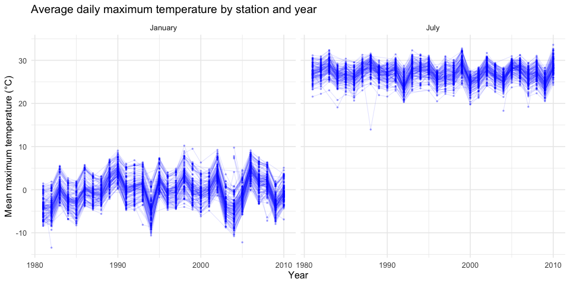
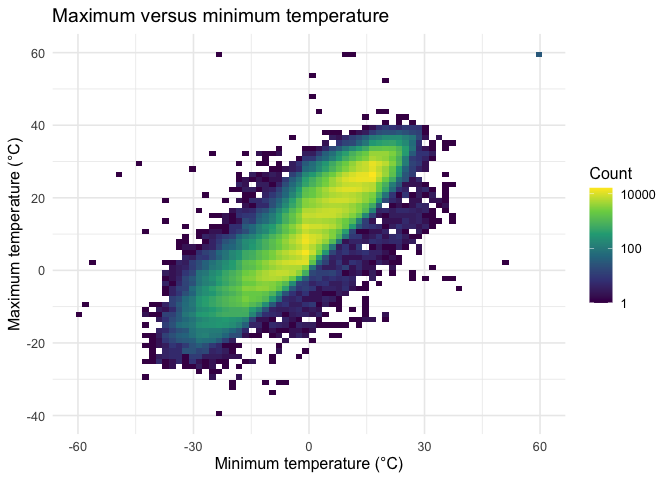
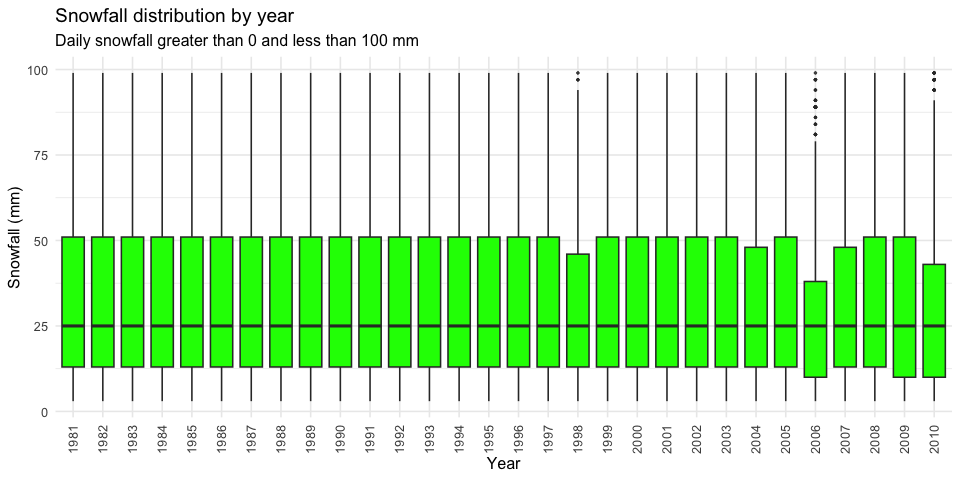
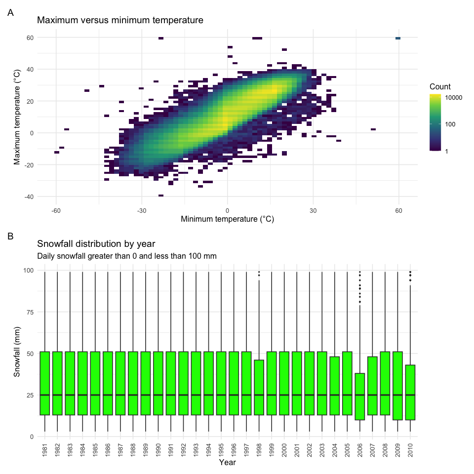
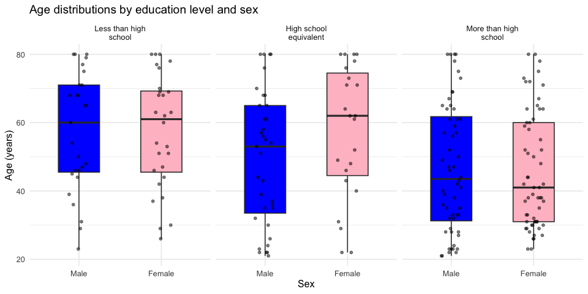
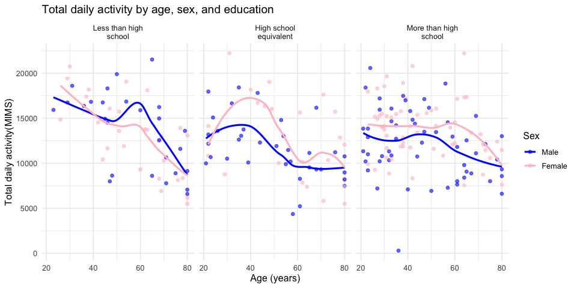
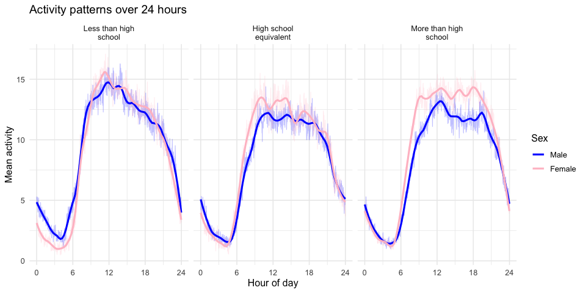

P8105 Homework3
================
Xinying Zou
2026-10-18

\##Problem 1

``` r
library(tidyverse)
```

    ## ── Attaching core tidyverse packages ──────────────────────── tidyverse 2.0.0 ──
    ## ✔ dplyr     1.2.1     ✔ readr     2.2.0
    ## ✔ forcats   1.0.1     ✔ stringr   1.6.0
    ## ✔ ggplot2   4.0.3     ✔ tibble    3.3.1
    ## ✔ lubridate 1.9.5     ✔ tidyr     1.3.2
    ## ✔ purrr     1.2.2     
    ## ── Conflicts ────────────────────────────────────────── tidyverse_conflicts() ──
    ## ✖ dplyr::filter() masks stats::filter()
    ## ✖ dplyr::lag()    masks stats::lag()
    ## ℹ Use the conflicted package (<http://conflicted.r-lib.org/>) to force all conflicts to become errors

``` r
library(p8105.datasets)
data("ny_noaa")

glimpse(ny_noaa)
```

    ## Rows: 2,595,176
    ## Columns: 7
    ## $ id   <chr> "US1NYAB0001", "US1NYAB0001", "US1NYAB0001", "US1NYAB0001", "US1N…
    ## $ date <date> 2007-11-01, 2007-11-02, 2007-11-03, 2007-11-04, 2007-11-05, 2007…
    ## $ prcp <int> NA, NA, NA, NA, NA, NA, NA, NA, NA, NA, NA, NA, NA, NA, NA, NA, 3…
    ## $ snow <int> NA, NA, NA, NA, NA, NA, NA, NA, NA, NA, NA, NA, NA, NA, NA, NA, 3…
    ## $ snwd <int> NA, NA, NA, NA, NA, NA, NA, NA, NA, NA, NA, NA, NA, NA, NA, NA, 0…
    ## $ tmax <chr> NA, NA, NA, NA, NA, NA, NA, NA, NA, NA, NA, NA, NA, NA, NA, NA, N…
    ## $ tmin <chr> NA, NA, NA, NA, NA, NA, NA, NA, NA, NA, NA, NA, NA, NA, NA, NA, N…

``` r
#To view the number of weather stasions & date rage
station_summary = ny_noaa %>%
  summarise(
    n_stations = n_distinct(id),
    first_date = min(date, na.rm = TRUE),
    last_date = max(date, na.rm = TRUE)
  )

print(station_summary)
```

    ## # A tibble: 1 × 3
    ##   n_stations first_date last_date 
    ##        <int> <date>     <date>    
    ## 1        747 1981-01-01 2010-12-31

``` r
missing_summary = ny_noaa %>%
  summarise(
    #view the number of the missing value in every column
    across(everything(), ~ sum(is.na(.x)))
  ) %>%
  #Change the data missing-value table form horizonal to vertical
  pivot_longer(
    cols = everything(),
    names_to = "variable",
    values_to = "missing_n"
  ) %>%
  #Calculate the missing percentage for each variable
  mutate(
    missing_percent = 100 * missing_n / nrow(ny_noaa)
  )

missing_summary
```

    ## # A tibble: 7 × 3
    ##   variable missing_n missing_percent
    ##   <chr>        <int>           <dbl>
    ## 1 id               0            0   
    ## 2 date             0            0   
    ## 3 prcp        145838            5.62
    ## 4 snow        381221           14.7 
    ## 5 snwd        591786           22.8 
    ## 6 tmax       1134358           43.7 
    ## 7 tmin       1134420           43.7

The NY NOAA dataset contains 2,595,176 observations and 7 variables from
747 weather stations in New York State, covering from January 1, 1981,
through December 31, 2010. Each row represents a daily weather record
for one station. The variables include station ID (`id`), observation
date(`date`), precipitation (`prcp`), snowfall (`snow`), snow depth
(`snwd`), maximum temperature (`tmax`), and minimum temperature
(`tmin`).

There are no missing values in `id` or `date`. However, 5.62% of
precipitation values, 14.69% of snowfall values, and 22.80% of snow
depth values are missing. Both maximum and minimum temperature have
about 43.71% missing values. Missing data are therefore a substantial
issue, like for temperature analyses. And it could affect comparisons
across stations and years if missingness varies between these groups.

``` r
#Cleaning data
noaa_clean = ny_noaa %>%
  mutate(
    year = lubridate::year(date),
    month = lubridate::month(date),
    day = lubridate::day(date),
    tmax = as.numeric(tmax)/10,
    tmin = as.numeric(tmin)/10,
    prcp = prcp/10
  )

glimpse(noaa_clean)
```

    ## Rows: 2,595,176
    ## Columns: 10
    ## $ id    <chr> "US1NYAB0001", "US1NYAB0001", "US1NYAB0001", "US1NYAB0001", "US1…
    ## $ date  <date> 2007-11-01, 2007-11-02, 2007-11-03, 2007-11-04, 2007-11-05, 200…
    ## $ prcp  <dbl> NA, NA, NA, NA, NA, NA, NA, NA, NA, NA, NA, NA, NA, NA, NA, NA, …
    ## $ snow  <int> NA, NA, NA, NA, NA, NA, NA, NA, NA, NA, NA, NA, NA, NA, NA, NA, …
    ## $ snwd  <int> NA, NA, NA, NA, NA, NA, NA, NA, NA, NA, NA, NA, NA, NA, NA, NA, …
    ## $ tmax  <dbl> NA, NA, NA, NA, NA, NA, NA, NA, NA, NA, NA, NA, NA, NA, NA, NA, …
    ## $ tmin  <dbl> NA, NA, NA, NA, NA, NA, NA, NA, NA, NA, NA, NA, NA, NA, NA, NA, …
    ## $ year  <dbl> 2007, 2007, 2007, 2007, 2007, 2007, 2007, 2007, 2007, 2007, 2007…
    ## $ month <dbl> 11, 11, 11, 11, 11, 11, 11, 11, 11, 11, 11, 11, 11, 11, 11, 11, …
    ## $ day   <int> 1, 2, 3, 4, 5, 6, 7, 8, 9, 10, 11, 12, 13, 14, 15, 16, 17, 18, 1…

``` r
summary(
  select(noaa_clean, tmax, tmin, prcp, snow, snwd)
)
```

    ##       tmax              tmin              prcp               snow          
    ##  Min.   :-38.90    Min.   :-59.400   Min.   :   0.000   Min.   :  -13.000  
    ##  1st Qu.:  5.00    1st Qu.: -3.900   1st Qu.:   0.000   1st Qu.:    0.000  
    ##  Median : 15.00    Median :  3.300   Median :   0.000   Median :    0.000  
    ##  Mean   : 13.98    Mean   :  3.029   Mean   :   2.982   Mean   :    4.987  
    ##  3rd Qu.: 23.30    3rd Qu.: 11.100   3rd Qu.:   2.300   3rd Qu.:    0.000  
    ##  Max.   : 60.00    Max.   : 60.000   Max.   :2286.000   Max.   :10160.000  
    ##  NAs    :1134358   NAs    :1134420   NAs    :145838     NAs    :381221     
    ##       snwd        
    ##  Min.   :   0.00  
    ##  1st Qu.:   0.00  
    ##  Median :   0.00  
    ##  Mean   :  37.31  
    ##  3rd Qu.:   0.00  
    ##  Max.   :9195.00  
    ##  NAs    :591786

``` r
snowfall_counts = noaa_clean %>%
  filter(!is.na(snow)) %>%
  count(snow, sort = TRUE) %>%
  slice_head(n = 10)

snowfall_counts
```

    ## # A tibble: 10 × 2
    ##     snow       n
    ##    <int>   <int>
    ##  1     0 2008508
    ##  2    25   31022
    ##  3    13   23095
    ##  4    51   18274
    ##  5    76   10173
    ##  6     8    9962
    ##  7     5    9748
    ##  8    38    9197
    ##  9     3    8790
    ## 10   102    6552

The most commonly observed snowfall value is 0 mm. Because many days
have no snowfall.

``` r
#Average maximum temperatures in January and July
monthly_temp = noaa_clean %>%
  filter(
    month %in% c(1, 7),
    !is.na(tmax)
  ) %>%
  group_by(id, year, month) %>%
  summarise(
    mean_tmax = mean(tmax),
    n_days = n(),
    .groups = "drop"
  ) %>%
  mutate(
    month = factor(
      month,
      levels = c(1, 7),
      labels = c("January", "July")
    )
  )

ggplot(
  monthly_temp,
  aes(x = year, y = mean_tmax, group = id)
) +
  geom_line(alpha = 0.15, color = "blue", linewidth = 0.3) +
  geom_point(alpha = 0.3, color = "blue", size = 0.5) +
  facet_wrap(~ month, nrow = 1) +
  labs(
    title = "Average daily maximum temperature by station and year",
    x = "Year",
    y = "Mean maximum temperature (°C)"
  ) +
  theme_minimal(base_size = 12)
```

<!-- -->

July is much warmer than January, and January shows larger changes
across years. Many stations follow similar patterns, with some years
being warmer or colder than others. For example, January 2003 looks
especially cold.

There are also a few possible outliers. One station has an unusually low
July average of about 14°C around 1988.

``` r
#Temperature relationship & snowfall distribution
temperature_plot = noaa_clean %>%
  filter(
    !is.na(tmax),
    !is.na(tmin)
  ) %>%
  ggplot(aes(x = tmin, y = tmax)) +
  geom_bin_2d(bins = 70) +
  scale_fill_viridis_c(
    transform = "log10",
    name = "Count"
  ) +
  labs(
    title = "Maximum versus minimum temperature",
    x = "Minimum temperature (°C)",
    y = "Maximum temperature (°C)"
  ) +
  theme_minimal(base_size = 12)

temperature_plot
```

<!-- -->

``` r
#the distribution of snowfall values greater than 0 and less than 100 separately by year
snowfall_plot = noaa_clean %>%
  filter(
    snow > 0,
    snow < 100
  ) %>%
  ggplot(aes(x = factor(year), y = snow)) +
  geom_boxplot(
    fill = "green",
    outlier.size = 0.5,
    outlier.alpha = 0.3
  ) +
  labs(
    title = "Snowfall distribution by year",
    subtitle = "Daily snowfall greater than 0 and less than 100 mm",
    x = "Year",
    y = "Snowfall (mm)"
  ) +
  theme_minimal(base_size = 12) +
  theme(
    axis.text.x = element_text(angle = 90, hjust = 1, vjust = 0.5)
  )

snowfall_plot
```

<!-- -->

``` r
library(patchwork)

combined_plot = (temperature_plot / snowfall_plot) + plot_annotation(tag_levels = "A")

combined_plot
```

<!-- -->
Maximum and minimum temperatures show a strong positive relationship
with a few unusual observations away from the main pattern.

Snowfall distributions are fairly similar across years, with medians
around 25 mm. Some years, such as 2006, have a smaller interquartile
range. There is no clear long-term trend among daily snowfall values
greater than 0 and less than 100 mm.

\##Problem 2

``` r
#Import data
covar_raw = read_csv(
  "data/nhanes_covar.csv",
  skip = 4,
  show_col_types = FALSE
)

accel_raw = read_csv(
  "data/nhanes_accel.csv",
  show_col_types = FALSE
)

glimpse(covar_raw)
```

    ## Rows: 250
    ## Columns: 5
    ## $ SEQN      <dbl> 62161, 62164, 62169, 62174, 62177, 62178, 62180, 62184, 6218…
    ## $ sex       <dbl> 1, 2, 1, 1, 1, 1, 1, 1, 2, 2, 1, 1, 2, 1, 1, 1, 2, 1, 2, 2, …
    ## $ age       <dbl> 22, 44, 21, 80, 51, 80, 35, 26, 17, 30, 70, 17, 16, 57, 36, …
    ## $ BMI       <dbl> 23.3, 23.2, 20.1, 33.9, 20.1, 28.5, 27.9, 22.1, 22.9, 22.4, …
    ## $ education <dbl> 2, 3, 2, 3, 2, 2, 3, 2, NA, 3, 2, NA, NA, 3, 1, 3, 3, 3, 1, …

``` r
dim(accel_raw)
```

    ## [1]  250 1441

``` r
accel_raw %>%
  select(SEQN, min1:min5) %>%
  head()
```

    ## # A tibble: 6 × 6
    ##    SEQN  min1  min2  min3  min4   min5
    ##   <dbl> <dbl> <dbl> <dbl> <dbl>  <dbl>
    ## 1 62161 1.11  3.12  1.47  0.938 1.60  
    ## 2 62164 1.92  1.67  2.38  0.935 2.59  
    ## 3 62169 5.85  5.18  4.76  6.48  6.85  
    ## 4 62174 5.42  3.48  3.72  3.81  6.85  
    ## 5 62177 6.14  8.06  9.99  6.60  4.57  
    ## 6 62178 0.167 0.429 0.131 1.20  0.0796

``` r
#clean data
covar_clean = covar_raw %>%
  rename(
    seqn = SEQN,
    bmi = BMI
  ) %>%
  drop_na(sex, age, bmi, education) %>%
  filter(age >= 21) %>%
  mutate(
    seqn = as.character(seqn),
    sex = factor(
      sex,
      levels = c(1, 2),
      labels = c("Male", "Female")
    ),
    education = factor(
      education,
      levels = c(1, 2, 3),
      labels = c(
        "Less than high school",
        "High school equivalent",
        "More than high school"
      )
    )
  )

glimpse(covar_clean)
```

    ## Rows: 228
    ## Columns: 5
    ## $ seqn      <chr> "62161", "62164", "62169", "62174", "62177", "62178", "62180…
    ## $ sex       <fct> Male, Female, Male, Male, Male, Male, Male, Male, Female, Ma…
    ## $ age       <dbl> 22, 44, 21, 80, 51, 80, 35, 26, 30, 57, 36, 28, 35, 38, 62, …
    ## $ bmi       <dbl> 23.3, 23.2, 20.1, 33.9, 20.1, 28.5, 27.9, 22.1, 22.4, 28.0, …
    ## $ education <fct> High school equivalent, More than high school, High school e…

``` r
covar_clean %>%
  summarise(
    n_participants = n(),
    min_age = min(age),
    max_age = max(age),
    missing_values = sum(is.na(pick(everything())))
  )
```

    ## # A tibble: 1 × 4
    ##   n_participants min_age max_age missing_values
    ##            <int>   <dbl>   <dbl>          <int>
    ## 1            228      21      80              0

``` r
#Tidy and merge activity data
accel_long = accel_raw %>%
  rename(seqn = SEQN) %>%
  mutate(
    seqn = as.character(seqn)
  ) %>%
  pivot_longer(
    cols = starts_with("min"),
    names_to = "minute",
    names_prefix = "min",
    names_transform = list(minute = as.integer),
    values_to = "mims"
  )

nhanes = covar_clean %>%
  left_join(accel_long, by = "seqn")

glimpse(nhanes)
```

    ## Rows: 328,320
    ## Columns: 7
    ## $ seqn      <chr> "62161", "62161", "62161", "62161", "62161", "62161", "62161…
    ## $ sex       <fct> Male, Male, Male, Male, Male, Male, Male, Male, Male, Male, …
    ## $ age       <dbl> 22, 22, 22, 22, 22, 22, 22, 22, 22, 22, 22, 22, 22, 22, 22, …
    ## $ bmi       <dbl> 23.3, 23.3, 23.3, 23.3, 23.3, 23.3, 23.3, 23.3, 23.3, 23.3, …
    ## $ education <fct> High school equivalent, High school equivalent, High school …
    ## $ minute    <int> 1, 2, 3, 4, 5, 6, 7, 8, 9, 10, 11, 12, 13, 14, 15, 16, 17, 1…
    ## $ mims      <dbl> 1.10600000, 3.11516667, 1.46750000, 0.93766667, 1.59866667, …

``` r
nhanes %>%
  summarise(
    n_participants = n_distinct(seqn),
    n_rows = n(),
    n_minutes = n_distinct(minute),
    missing_mims = sum(is.na(mims))
  )
```

    ## # A tibble: 1 × 4
    ##   n_participants n_rows n_minutes missing_mims
    ##            <int>  <int>     <int>        <int>
    ## 1            228 328320      1440            0

``` r
participant_df = nhanes %>%
  distinct(seqn, sex, age, bmi, education)

education_table = participant_df %>%
  count(education, sex) %>%
  pivot_wider(
    names_from = sex,
    values_from = n,
    values_fill = 0
  ) %>%
  arrange(education)

knitr::kable(
  education_table,
  col.names = c("Education level", "Men", "Women"),
  caption = "Number of participants by education level and sex"
)
```

| Education level        | Men | Women |
|:-----------------------|----:|------:|
| Less than high school  |  27 |    28 |
| High school equivalent |  35 |    23 |
| More than high school  |  56 |    59 |

Number of participants by education level and sex

``` r
#age distributions by education and sex
ggplot(
  participant_df,
  aes(x = sex, y = age, fill = sex)
) +
  geom_boxplot(width = 0.5, outlier.shape = NA) +
  geom_jitter(
    width = 0.12,
    height = 0,
    alpha = 0.5,
    size = 1.3
  ) +
  facet_wrap(
    ~ education,
    nrow = 1,
    labeller = label_wrap_gen(width = 20)
  ) +
  scale_fill_manual(
    values = c("Male" = "blue", "Female" = "pink")
  ) +
  labs(
    title = "Age distributions by education level and sex",
    x = "Sex",
    y = "Age (years)"
  ) +
  theme_minimal(base_size = 12) + theme(legend.position = "none")
```

<!-- -->

The more-than-high-school group is the largest, with 56 men and 59
women, and generally has younger participants. The high-school-
equivalent group includes more men than women, but women have a higher
median age. In the less-than-high-school group, the numbers of men and
women are nearly equal, and their age distributions are similar. Ages
vary widely within all groups.

``` r
#Total activity and age
activity_total = nhanes %>%
  group_by(seqn, sex, age, bmi, education) %>%
  summarise(
    total_activity = sum(mims),
    .groups = "drop"
  )

ggplot(
  activity_total,
  aes(x = age, y = total_activity, color = sex)
) +
  geom_point(alpha = 0.6) +
  geom_smooth(method = "loess", se = FALSE) +
  facet_wrap(
    ~education,
    nrow = 1,
    labeller = label_wrap_gen(width = 20)
  ) +
  scale_color_manual(
    values = c("Male" = "blue", "Female" = "pink")
  ) +
  labs(
    title = "Total daily activity by age, sex, and education",
    x = "Age (years)",
    y = "Total daily activity(MIMS)",
    color = "Sex"
  ) +
  theme_minimal(base_size = 12)
```

    ## `geom_smooth()` using formula = 'y ~ x'

<!-- -->

Total daily activity generally decreases with age across all education
groups, although the trends are not strictly linear. Women tend to have
higher activity levels than men in the high-school-equivalent and
more-than-high-school groups. Sex differences are less consistent in the
less-than-high-school group. Activity levels also vary widely among
participants of similar ages.

``` r
#Activity patterns over 24 hours
activity_by_minute = nhanes %>%
  group_by(education, sex, minute) %>%
  summarise(
    mean_mims = mean(mims),
    .groups = "drop"
  ) %>%
  mutate(hour = (minute - 1) / 60)

ggplot(
  activity_by_minute,
  aes(x = hour, y = mean_mims, color = sex)
) +
  geom_line(alpha = 0.25, linewidth = 0.4) +
  geom_smooth(
    method = "loess",
    formula = y ~ x,
    span = 0.15,
    se = FALSE
  ) +
  facet_wrap(
    ~education,
    nrow = 1,
    labeller = label_wrap_gen(width = 20)
  ) +
  scale_color_manual(
    values = c("Male" = "blue", "Female" = "pink")
  ) +
  scale_x_continuous(
    breaks = seq(0, 24, by = 6),
    limits = c(0, 24)
  ) +
  labs(
    title = "Activity patterns over 24 hours",
    x = "Hour of day",
    y = "Mean activity",
    color = "Sex"
  ) +
  theme_minimal(base_size = 12)
```

<!-- -->

All three education groups show low activity overnight, a sharp rise in
the morning, and a decline in the evening. The less-than-high-school
group has a clear peak around noon, with similar daytime patterns for
men and women. Women generally have higher daytime activity than men in
the other two groups, especially in the more-than-high-school group.

\##Problem 3
